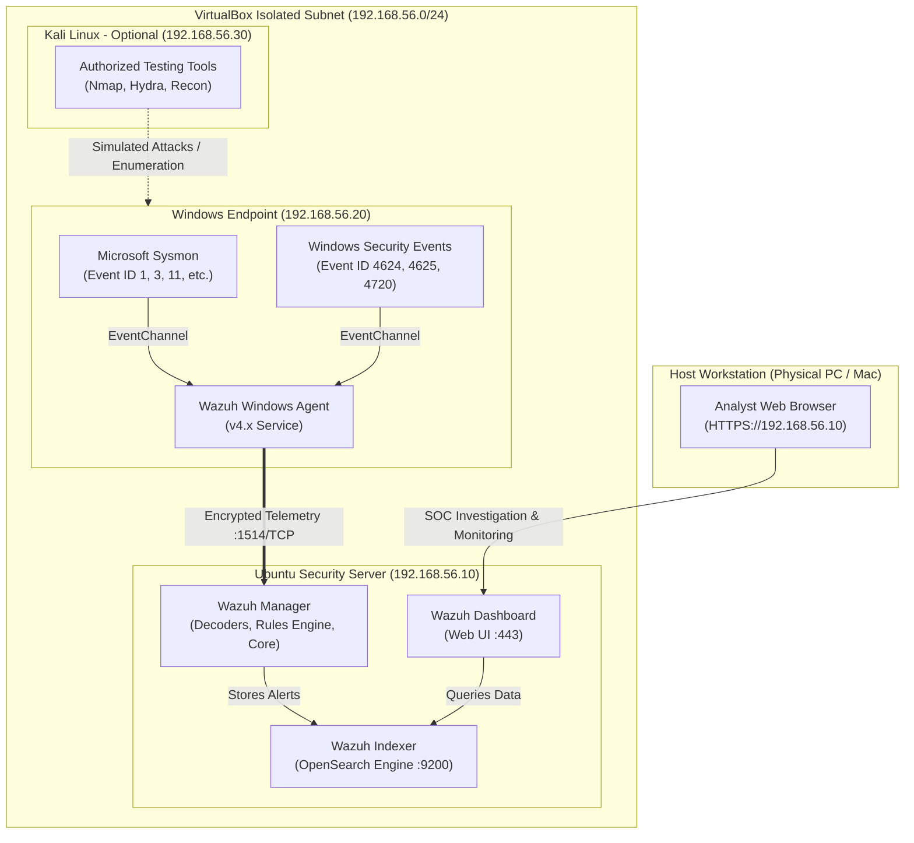

# 🛡️ Cybersecurity SOC Home Lab

[](LICENSE)
[](https://www.virtualbox.org/)
[](https://documentation.wazuh.com/)
[](https://learn.microsoft.com/sysinternals/downloads/sysmon)
[](https://attack.mitre.org/)

> A comprehensive, step-by-step guide designed for beginners to build, configure, and operate their own **Security Operations Center (SOC) Home Lab** from scratch using free and open-source tools.

---

## 📖 Table of Contents

- [Project Overview](#-project-overview)
- [Key Learning Objectives](#-key-learning-objectives)
- [Core Technology Stack](#-core-technology-stack)
- [Lab Architecture](#-lab-architecture)
- [Documentation Roadmap](#-documentation-roadmap)
- [Quick Start Guide](#-quick-start-guide)
- [Hands-On Exercises & Scenarios](#-hands-on-exercises--scenarios)
- [Safety & Legal Disclaimer](#-safety--legal-disclaimer)
- [Contributing](#-contributing)
- [License](#-license)
- [Contact & Connect](#-contact--connect)

---

## 🎯 Project Overview

Building a Security Operations Center (SOC) home lab is one of the most effective ways to break into cybersecurity and gain hands-on defensive security skills. This project provides a complete blueprint to set up a mini enterprise security environment on your personal computer.

By creating an isolated virtual network hosting a **Windows endpoint**, rich **Sysmon endpoint telemetry**, and a centralized **Wazuh SIEM/XDR manager**, you will learn how telemetry flows, how detection rules trigger, how to map adversary techniques to the **MITRE ATT&CK** framework, and how to write professional incident reports.

---

## 🎓 Key Learning Objectives

By completing this home lab, you will understand:
1. **Virtualization & Network Isolation**: How to safely isolate testing environments using VirtualBox Host-Only and NAT networking.
2. **Endpoint Telemetry & Auditing**: How to configure Microsoft Sysmon to capture process lineage, network sockets, hash calculations, and file creation.
3. **SIEM / XDR Deployment**: How to install and manage the Wazuh indexer, manager, and dashboard.
4. **Log Forwarding & Parsing**: How endpoint logs are encrypted, shipped via agents, parsed with decoders, and correlated with rules.
5. **Detection Engineering & MITRE ATT&CK**: How to map simulated attacks (credential access, privilege escalation, obfuscation) to MITRE ATT&CK techniques.
6. **Incident Triage & Response**: How Tier-1 SOC analysts investigate alerts, perform root-cause analysis, and draft structured incident reports.

---

## 🧰 Core Technology Stack

| Tool | Purpose | Official Documentation |
| :--- | :--- | :--- |
| **Oracle VM VirtualBox** | Type-2 Hypervisor to run isolated virtual machines | [VirtualBox Docs](https://www.virtualbox.org/wiki/Documentation) |
| **Ubuntu Server (22.04 LTS)** | Lightweight Linux server hosting the Wazuh security stack | [Ubuntu Server Docs](https://ubuntu.com/server/docs) |
| **Wazuh (v4.x)** | Open-source SIEM & XDR engine for threat detection and compliance | [Wazuh Documentation](https://documentation.wazuh.com/current/) |
| **Microsoft Windows 10/11** | Monitored endpoint simulating an enterprise corporate workstation | [Microsoft Eval Center](https://www.microsoft.com/evalcenter) |
| **Microsoft Sysinternals Sysmon** | Deep system telemetry monitoring (Process, Network, File, Registry) | [Sysinternals Sysmon](https://learn.microsoft.com/sysinternals/downloads/sysmon) |
| **Kali Linux** *(Optional)* | Controlled adversary emulation & testing workstation | [Kali Linux Docs](https://www.kali.org/docs/) |
| **Wireshark** | Packet analyzer for deep packet inspection and network analysis | [Wireshark Docs](https://www.wireshark.org/docs/) |
| **MITRE ATT&CK** | Globally accessible knowledge base of adversary tactics and techniques | [MITRE ATT&CK Enterprise](https://attack.mitre.org/matrices/enterprise/) |

---

## 🏛️ Lab Architecture

The lab operates on an isolated private subnet (`192.168.56.0/24`) managed by VirtualBox Host-Only networking, preventing simulated traffic from leaking to your home network or the internet.



---

## 📚 Documentation Roadmap

This repository is organized into a modular, step-by-step documentation structure:

1. **[System Prerequisites & Sizing](docs/prerequisites.md)**  
   Hardware requirements (RAM, CPU, disk allocation breakdown), software downloads, and host virtualization verification.
2. **[Lab Architecture & Data Flow](docs/lab-architecture.md)**  
   In-depth explanation of every subsystem, listening ports, and the telemetry lifecycle from Windows to the Wazuh indexer.
3. **[Safe Virtual Networking](docs/network-configuration.md)**  
   Understanding VirtualBox network modes (NAT vs Host-Only vs Internal), dual-adapter strategy, and preventing host leaks.
4. **[VM Installation Guide](docs/installation-guide.md)**  
   Step-by-step walkthrough for provisioning the Ubuntu Server and Windows Evaluation VMs, plus snapshot best practices.
5. **[Wazuh SIEM/XDR Setup](docs/wazuh-setup.md)**  
   Running the official all-in-one assistant, extracting administrative credentials, configuring UFW, and logging into the dashboard.
6. **[Windows Endpoint & Sysmon Setup](docs/windows-endpoint-setup.md)**  
   Installing Microsoft Sysmon with SwiftOnSecurity configuration, installing the Wazuh agent, and configuring `ossec.conf`.
7. **[Troubleshooting Guide](docs/troubleshooting.md)**  
   Solutions for agent disconnection, firewall blocks, indexer memory limits (OOM), and self-signed certificate warnings.
8. **[Visual Diagrams & Schematics](diagrams/README.md)**  
   Detailed network topologies, sequence diagrams, and Mermaid source code.

---

## ⚡ Quick Start Guide

For an experienced user who already has VirtualBox installed, here is the high-level roadmap:

1. **Configure Host-Only Network**: Create a Host-Only adapter in VirtualBox (`192.168.56.1/24`).
2. **Deploy Ubuntu 22.04 LTS VM**: Allocate 4GB+ RAM, 2 vCPUs, static IP `192.168.56.10`.
3. **Install Wazuh Server**:
   ```bash
   curl -sO https://packages.wazuh.com/4.x/wazuh-install.sh && sudo bash ./wazuh-install.sh -a
   ```
4. **Deploy Windows 10/11 VM**: Allocate 4GB RAM, 2 vCPUs, static IP `192.168.56.20`.
5. **Install Sysmon on Windows**:
   ```powershell
   .\Sysmon64.exe -i sysmonconfig.xml -accepteula
   ```
6. **Install Wazuh Agent on Windows**:
   Deploy MSI, point to `192.168.56.10`, add `Microsoft-Windows-Sysmon/Operational` to `ossec.conf`, and start `WazuhSvc`.
7. **Verify Dashboard**: Navigate to `https://192.168.56.10` and view incoming alerts.

---

## 🧪 Hands-On Exercises & Scenarios

- **[Exercise 1: Windows Event & Telemetry Monitoring](exercises/windows-event-monitoring.md)**  
  Verify telemetry flow, observe Sysmon Event ID 1 (Process Create) & Event ID 3 (Network Connection), detect local account creation (T1087 / T1136), and detect obfuscated PowerShell execution (T1059.001 / T1027).
- **[Exercise 2: SOC Alert Investigation Workflow](exercises/alert-investigation.md)**  
  Follow the 5-phase triage lifecycle to investigate simulated brute-force authentication attempts and correlate alerts with Sysmon process creation.
- **[Sample Incident Report & Reusable Template](incident-reports/sample-incident-report.md)**  
  Review a production-grade incident report for an obfuscated PowerShell incident, and use the included markdown template for your own documentation portfolio.

---

## ⚠️ Safety & Legal Disclaimer

> [!CAUTION]
> **Strictly for Educational and Authorized Defensive Testing Only.**
> 
> The techniques, exercises, and configurations provided in this repository are intended solely for educational purposes within an isolated, private virtual laboratory that you own and control. 
> 
> - **Never** expose vulnerable test endpoints to the public internet.
> - **Never** use Bridged networking for security testing virtual machines.
> - **Never** execute security testing tools, port scans, or exploitation scripts against systems without prior explicit, written authorization from the owner.
> - The author assumes no liability for misuse of the information contained herein.

---

## 🤝 Contributing

Contributions, issues, and feature suggestions are welcome!
1. Fork the Project.
2. Create your Feature Branch (`git checkout -b feature/NewExercise`).
3. Commit your Changes (`git commit -m 'Add new Sysmon detection exercise'`).
4. Push to the Branch (`git push origin feature/NewExercise`).
5. Open a Pull Request.

---

## 📄 License

Distributed under the **MIT License**. See [`LICENSE`](LICENSE) for more information.

---

## 📬 Contact & Connect

- **Project Creator**: Aditya
- **GitHub**: [@AdityaTamakuwala](https://github.com/AdityaTamakuwala)
- **LinkedIn**: [Aditya Tamakuwala](https://www.linkedin.com/in/aditya-tamakuwala-122442316)
- **Email**: [adityatamakuwala72@gmail.com](mailto:adityatamakuwala72@gmail.com)
