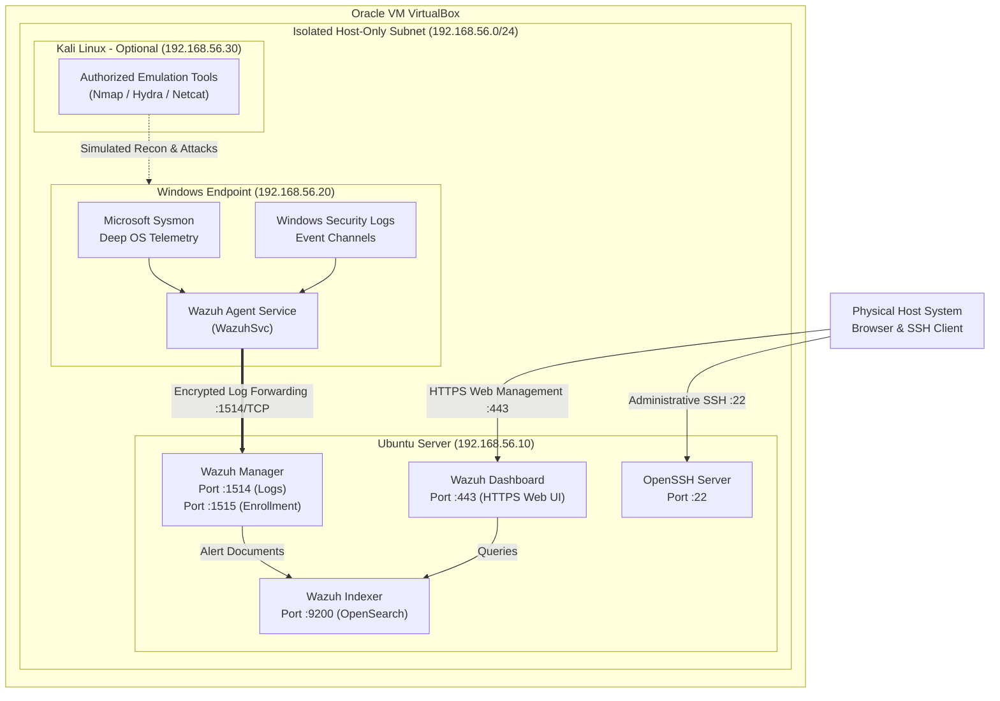
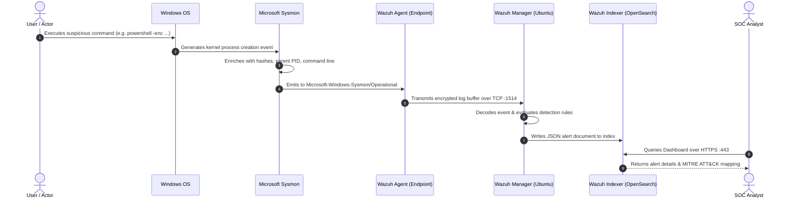

# Architecture & Network Diagrams

This directory contains visual architectural specifications, network diagrams, and telemetry pipeline diagrams for the **Cybersecurity SOC Home Lab**.

---

## 1. Network Topology & Port Map

This diagram illustrates how virtual machines connect across the isolated Host-Only network and which ports are utilized for log shipping and administrative operations:



---

## 2. Telemetry Ingestion Sequence Diagram

This sequence diagram illustrates the lifecycle of a security event from execution on the endpoint to alert visualization:



---

## 3. How to Render and Modify These Diagrams

All diagrams in this repository are written in **Mermaid.js** format:
- **GitHub Native Rendering**: GitHub automatically renders all ```mermaid blocks directly in your browser.
- **Editing Tools**:
  - [Mermaid Live Editor](https://mermaid.live/) (Web-based interactive diagram builder).
  - VS Code / Antigravity Markdown Preview with Mermaid support.
  - Export to PNG / SVG via `mermaid-cli` (`mmdc`) if high-resolution image files are desired.
