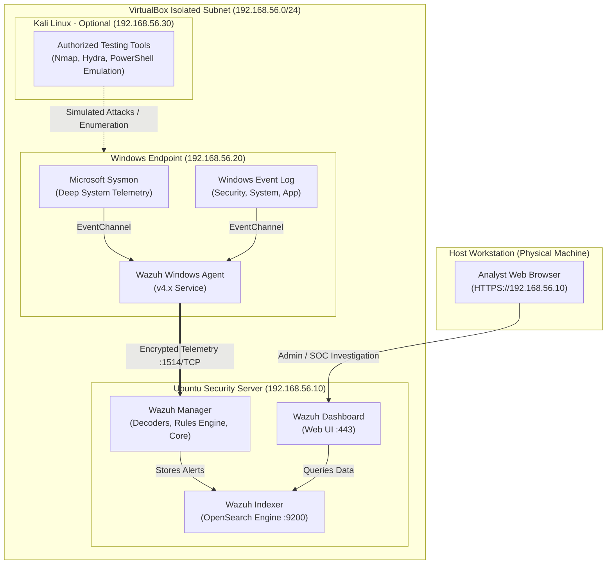

# SOC Lab Architecture & Data Flow

This document details the architectural layout, component responsibilities, networking topology, and telemetry pipeline of your Cybersecurity SOC Home Lab.

---

## 1. High-Level Architecture Overview

The lab simulates a small enterprise environment consisting of a **monitored endpoint**, a centralized **SIEM/XDR security server**, and an **isolated testing system** to generate authorized security events.



---

## 2. Core Architectural Components

### A. Monitored Endpoint: Windows 10/11 Workstation
- **Role**: Emulates a corporate workstation subject to routine user activity, misconfigurations, and simulated threat activity.
- **Telemetry Engine (Microsoft Sysmon)**: Extends standard Windows auditing by providing detailed system activity tracking:
  - Event ID 1: Process Creation (including full command-line arguments and process parentage)
  - Event ID 3: Network Connections (source/dest IP, port, process)
  - Event ID 7: Image Loaded (DLL monitoring)
  - Event ID 11: File Create operations
  - Event ID 12/13: Registry modifications
- **Wazuh Agent**: Lightweight background service (`WazuhSvc`) running on the endpoint. It polls local Windows event logs and Sysmon operational logs via the Windows Event Channel API, buffers records, and securely transmits them over an encrypted TLS channel.

### B. Security Monitoring Server: Ubuntu Server (Wazuh All-In-One)
The Wazuh platform operates as an all-in-one SIEM and Extended Detection and Response (XDR) system containing three integrated subsystems:
1. **Wazuh Manager (Engine)**:
   - Receives events from registered agents over port `1514/TCP`.
   - Normalizes unstructured and semi-structured logs using **Decoders**.
   - Evaluates parsed data against thousands of predefined detection **Rules** categorized by severity (Levels 0–15) and mapped to **MITRE ATT&CK** techniques.
   - Manages agent enrollment and cryptographic keys over port `1515/TCP`.
2. **Wazuh Indexer**:
   - Highly scalable search and analytics engine (based on OpenSearch).
   - Indexes alert JSON objects into time-series indices (`wazuh-alerts-4.x-*`).
3. **Wazuh Dashboard**:
   - Web user interface served over HTTPS on port `443`.
   - Offers real-time dashboards for security events, compliance (PCI-DSS, NIST 800-53, HIPAA), agent status, MITRE ATT&CK matrices, and rule configuration.

### C. Security Testing System: Kali Linux (Optional)
- **Role**: Serves exclusively as an adversary emulation workstation in an isolated network segment.
- **Usage**: Used to trigger security events in a controlled manner (e.g., SMB reconnaissance, authentication brute-force emulation, web directory enumeration) to verify that Wazuh rules alert as expected.

---

## 3. Telemetry Pipeline: From Event to Alert

Understanding the path an event takes is fundamental to SOC analysis:

```
[System Action on Windows Endpoint]
          │
          ▼
[Windows Event Viewer & Sysmon Operational Channel]
          │
          ▼
[Wazuh Agent reads EventChannel via ossec.conf]
          │
          ▼ (Encrypted TCP :1514)
[Wazuh Manager receives log record]
          │
          ▼
[Pre-decoders & Decoders extract fields: user, process, hashes, IP]
          │
          ▼
[Rules Engine matches condition (e.g. Rule 92002: Mimikatz detected)]
          │
          ▼
[Alert Document generated in JSON format]
          │
          ▼
[Wazuh Indexer writes alert to OpenSearch index]
          │
          ▼
[SOC Analyst queries & visualizes alert on Wazuh Dashboard (HTTPS :443)]
```

---

## 4. Key Network Ports Summary

| Port / Protocol | Source | Destination | Purpose |
| :--- | :--- | :--- | :--- |
| **1514 / TCP** | Windows Endpoint | Wazuh Server | Agent-to-Server encrypted log communication |
| **1515 / TCP** | Windows Endpoint | Wazuh Server | Agent registration & authentication service |
| **9200 / TCP** | Wazuh Manager / Dashboard | Wazuh Indexer | RESTful API for indexing and querying alerts |
| **443 / TCP** | Host Browser | Wazuh Dashboard | HTTPS web interface access for SOC analysts |
| **22 / TCP** | Host Workstation | Ubuntu Server | Administrative SSH access |

---

## Next Step
Proceed to [Network Configuration](network-configuration.md) to set up safe virtual networking in VirtualBox.
